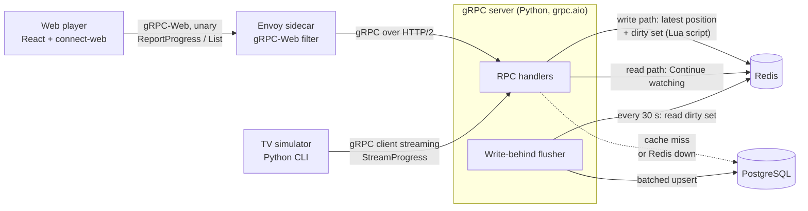

# Watch-Progress Service: Design Doc

Author: Andrii Hapon · Created: 2026-11-09 · Status: Draft

## 1. Context and scope

Viewers who watch on several devices (phone, TV, browser) want to resume a video where they stopped and to see their unfinished videos in a "Continue watching" row, sorted by last watched. This service is a standalone backend that records playback position and serves that row. It is a demo, so no larger streaming product exists around it, and a few fixed mock users stand in for accounts. The technical goal is to absorb a very high rate of small position writes (each playing video reports every few seconds) without writing every one to the database. The user-facing acceptance criteria are that a second device resumes at the position the first one reached, and that the row shows exactly the unfinished videos. The design and measurements target demo scale; 10M concurrent viewers is analysed on paper only (section 8).

## 2. Goals and non-goals

**Goals**

User-facing (acceptance criteria):
- A user who watches on one device resumes at the latest position on another. Conflicting writes are resolved by last write wins, compared by the client's event time, not arrival time.
- A "Continue watching" row lists the user's unfinished videos, most recently watched first, each with progress. A video past 90% counts as finished and leaves the row. The user can remove a video from the row.
- Two write paths: the web player sends unary reports; a TV simulator uses client streaming.
- A position written to Redis is visible to the next read.

Technical (demo scale, measured with a local k6 load test in Phase 5):
- Sustain the whole range of 2,000–4,000 heartbeats/s. Assumption: one heartbeat per stream every 5 s, so this is about 10,000–20,000 concurrent streams.
- p99 latency under 20 ms, excluding network and Envoy. For unary calls it is server handler time. For `StreamProgress`, whose handler runs for the whole session, it is per-event processing time: from the handler reading an event to its Redis write finishing.
- About 6× fewer PostgreSQL row writes than one write per heartbeat during continuous playback (heartbeats received ÷ PostgreSQL row writes). Assumption: a 30 s flush interval and one heartbeat per key every 5 s, so about 6 heartbeats collapse into one row write. Immediate flushes (pause, stream close, finish) add writes, so the measured ratio will be lower.
- Durability: a server crash loses no acknowledged heartbeat, because the latest position and the dirty set live in Redis, not in server memory. A Redis restart loses at most about 1 s (AOF with `appendfsync everysec`). Pause, session end, stream close and finishing a video trigger an immediate flush.
- If Redis is down, writes go straight to PostgreSQL at reduced capacity.

**Non-goals**
- Video hosting (5–10 public-domain sample videos are used).
- Recommendations.
- Real authentication or sign-up (a demo token and a few fixed users).

## 3. Overview

Two clients write to one Python gRPC server (`grpc.aio`). Browsers cannot do gRPC client streaming, so the web player sends a unary `ReportProgress` about every 5 s through an Envoy gRPC-Web sidecar. The TV simulator (and the k6 load test) calls the server directly and keeps one client stream per playback session. If Envoy costs too much time, `connectrpc` for Python (beta) can replace it. Each heartbeat is written to Redis first, which holds the latest position per user and video plus a set of keys waiting to be flushed, and the server acknowledges only after that write. PostgreSQL is the durable source of truth: a write-behind flusher upserts batches into it every 30 s and flushes a key immediately on pause, session end, stream close and finishing a video. The flusher runs as a background task inside the server process to keep deployment simple. To scale, it should move to a separate worker, so its CPU work does not compete with request handling for the event loop. The "Continue watching" row is read from Redis, falling back to PostgreSQL when the cache is cold.

## 4. API

Contract: `proto/watchprogress/v1/watch_progress.proto`, linted with `buf lint`, checked with `buf breaking`.

**RPCs**

| RPC | Type | Caller | Purpose |
| --- | --- | --- | --- |
| `ReportProgress` | unary | web player | One report about every 5 s, and on pause, seek and tab hide |
| `StreamProgress` | client streaming | TV simulator, k6 | One stream per playback session; one reply, `StreamProgressSummary`, when the stream ends |
| `GetProgress` | unary | web player | Latest position of one video, to resume playback |
| `ListContinueWatching` | unary | web player | The row: unfinished videos, most recently watched first |
| `RemoveFromContinueWatching` | unary | web player | Remove one video from the row |

**Key messages.** `ProgressEvent` is shared by `ReportProgress` and `StreamProgress`:

| Field | Meaning |
| --- | --- |
| `video_id` | Which video; must exist in the `videos` table |
| `position_seconds` | Playback position; at least 0 and at most the video's duration |
| `client_time` | Event time on the device; decides last write wins |
| `session_id` | One playback session |
| `reason` | Why the client sent the event: periodic, pause, seek, tab hidden or session end. Pause and session end are flushed immediately; the server itself flushes on stream close and on finishing a video |

The event carries no duration. The server uses `videos.duration_seconds` for validation and the 90% finished rule.

`RemoveFromContinueWatching` also carries a `client_time` and a `session_id`. A removal and a heartbeat are ordered by the same pair as two heartbeats (section 6), and the later one wins.

**Why unary for web, client streaming for TV.** Browsers cannot do gRPC client streaming: gRPC-Web and Connect in the browser support only unary and server-streaming calls. So the web player sends a small unary report every 5 s. The TV path uses one long-lived client stream per session. The stream's only reply comes when it ends, so the client does not learn mid-session whether an event was accepted. The server stores each event in Redis before it reads the next one. An invalid event is skipped and the stream continues. `events_accepted` in the reply counts the valid events the server processed, including an older event that lost the last-write-wins comparison; invalid and rate-limited events are not counted.

**Identity.** The user ID comes from the `authorization` metadata, never from a request field. The token is a random per-user token. The server stores only its hash in the `user_tokens` table (section 5) and loads the table into memory at startup. An interceptor hashes the presented token and looks up the user ID, so a request makes no database call. A token added while the server runs is known after a restart. For streams the token is checked once, when the stream opens. A missing or unknown token returns `UNAUTHENTICATED`.

**Validation (`INVALID_ARGUMENT`).** Negative `position_seconds`, `position_seconds` greater than the video's duration, empty `video_id`, unknown `video_id`. The server keeps the video list in memory (loaded from the `videos` table at startup), so validation costs no database call per heartbeat. A missing `client_time`, or one more than 15 minutes later than the server's receive time, is clamped to the server's receive time. The 15 minute tolerance allows for device clock error. A device whose clock is fast by less than that can still win conflicts it should not.

**Pagination.** `ListContinueWatching` follows AIP-158: `page_size` and an opaque `page_token`, with `next_page_token` in the response. The default `page_size` is 25 and the maximum is 100; a larger value is reduced to 100. A negative `page_size` or a malformed `page_token` returns `INVALID_ARGUMENT`.

**Status codes**

| Situation | Code |
| --- | --- |
| Bad field value (see validation), bad `page_token` | `INVALID_ARGUMENT` |
| Missing or unknown token | `UNAUTHENTICATED` |
| `GetProgress` with no stored position; `RemoveFromContinueWatching` for a video not in the row | `NOT_FOUND` |
| Over the per-user rate limit (40 requests per minute) | `RESOURCE_EXHAUSTED` |
| Redis and PostgreSQL both unavailable, or `wp:dirty` at its size cap | `UNAVAILABLE` |
| Deadline passed | `DEADLINE_EXCEEDED` |

**Deadlines.** Every unary call has a deadline. The web client sets 5 s. The server applies a default of 5 s when a client sets none, and passes the time remaining to its Redis and PostgreSQL calls. `StreamProgress` is not covered by that default: it has a deadline of 55 minutes for the whole stream. Assumption: Cloud Run's maximum request timeout is 60 minutes (not yet verified). When the deadline passes, the client reopens the stream and keeps the same `session_id`, so one playback session can span several streams. The server also closes a stream that has sent no event for 10 minutes (idle timeout), which frees resources held by a client that vanished.

## 5. Data model

**PostgreSQL**

`videos`: the catalogue of 5–10 sample videos, seeded on deploy. The video files are served from static hosting.

| Column | Meaning |
| --- | --- |
| `video_id` (primary key) | Identifier used in the API |
| `title` | Display title |
| `url` | Location of the video file |
| `duration_seconds` | True length of the video |

`user_tokens`: the credentials. Rows are seeded and never created through the API.

| Column | Meaning |
| --- | --- |
| `token_hash` (primary key) | SHA-256 of the token; the token itself is never stored |
| `user_id` | The user the token belongs to |

There are two seed paths, run by separate `make` targets. `seed-demo` creates the few fixed users with hardcoded tokens and runs in every environment. `seed-loadtest` generates thousands of users with tokens derived deterministically from the user's index, so k6 can compute them, and runs only against a local database (it refuses any other database URL).

`watch_progress`: the latest state per user and video; the source of truth.

| Column | Meaning |
| --- | --- |
| `user_id`, `video_id` (primary key) | The user (from `user_tokens`) and the video |
| `position_s`, `duration_s` | Latest position, and a snapshot of the video's duration at write time |
| `event_time` | `client_time` of the latest accepted event (heartbeat or removal); decides last write wins |
| `session_id` | Session of that event; breaks ties when two events have the same `event_time` |
| `finished` | True when position is at least 90% of the video's duration; cleared by a later event below 90% |
| `removed` | True after the user removes the video from the row; cleared by a later heartbeat |
| `updated_at` | When the row was last written |

Index: a partial index on `(user_id, event_time DESC)` where `finished` and `removed` are both false. It serves the "Continue watching" query and stays small, because finished and removed rows are left out. The primary key serves `GetProgress`.

**Redis**

| Key | Type | Content | Lifetime |
| --- | --- | --- | --- |
| `wp:{user}:{video}` | hash | Latest position, `client_time` and flags | No TTL while unflushed. After a successful flush it gets a TTL of 5 minutes, and the next write clears that TTL |
| `cw:{user}` | sorted set | Video IDs scored by event time (recent activity of the row) | No TTL. The Lua script removes finished and removed videos; a member whose position hash has expired is removed when the row is read (section 7) |
| `wp:dirty` | set | Keys waiting to be flushed to PostgreSQL | No expiry; a key leaves the set after a successful flush |
| `wp:flush-now` | set | Keys to flush ahead of the 30 s tick (pause, session end, stream close, finished) | No expiry; a key leaves the set after a successful flush |

When a position hash expires, reads fall back to PostgreSQL.

## 6. Write path

**Flow**

1. The client sends a `ProgressEvent`. An interceptor maps the token to a user ID. The handler validates the event (section 4) and clamps `client_time` if needed.
2. The handler runs one Lua script in Redis. If the event's `client_time` is later than the stored one, the script writes the position hash, updates the score in `cw:{user}`, adds the key to `wp:dirty` and clears the key's TTL. It also decides whether the video is finished (see below). The handler passes the video's duration to the script as an argument. An older event is discarded.
3. The handler acknowledges the call. The acknowledgement comes after the Redis write and never waits for PostgreSQL.
4. Every 30 s the flusher reads `wp:dirty` and writes the keys to PostgreSQL in chunks of 500 rows, one transaction per chunk. After a chunk commits, each key leaves `wp:dirty` and gets a TTL of 5 minutes, but only if its stored (`client_time`, `session_id`) still equals the pair the flusher read. A key rewritten during the flush stays dirty and goes out in the next flush. This compare-and-remove is atomic (a Lua script).
5. Some events need to reach PostgreSQL sooner: pause, session end, stream close and finishing a video. For a pause, a session end and finishing, the Lua script adds the key to `wp:flush-now`, atomically with the write. On stream close the handler adds the stream's key with a separate command. The flusher polls that set every 5 s and writes its keys without waiting for the 30 s tick. The handler does not wait for that write. A key in `wp:flush-now` is also in `wp:dirty`, so if the flusher is down the regular flush still covers it.

**Last write wins.** Redis and PostgreSQL both compare the pair (`client_time`, `session_id`), never arrival time. The later `client_time` wins; if the two are equal, the greater `session_id` wins, so a tie resolves the same way whatever the arrival order. The PostgreSQL upsert is `INSERT … ON CONFLICT (user_id, video_id) DO UPDATE … WHERE (excluded.event_time, excluded.session_id) > (watch_progress.event_time, watch_progress.session_id)`.

**Finished at 90%.** A video is finished when `position_seconds` is at least 90% of `videos.duration_seconds`. The Lua script evaluates the rule on every write, so a finished video leaves `cw:{user}` at once, and the flusher copies the `finished` flag to PostgreSQL. A later event below 90% makes it unfinished again.

**Batch size and interval.** Interval 30 s, chunks of 500 rows. With one heartbeat per key every 5 s, about 6 heartbeats become one row write during continuous playback (section 2).

**Idempotency.** Replaying a chunk is safe: the `WHERE` clause skips any row whose `event_time` is not newer than the stored one. Both instances on Cloud Run run a flusher with no coordination. Overlapping flushes only repeat work, and they can lower the write-reduction ratio below the single-instance figure (in the worst case with two instances, to about half). This is accepted for the demo.

**What can be lost**

| Failure | Loss |
| --- | --- |
| Server crash | No acknowledged heartbeat; the latest positions and `wp:dirty` live in Redis |
| PostgreSQL down | Nothing; dirty keys have no TTL and stay in Redis until a flush succeeds |
| Redis restart | At most about 1 s (AOF with `appendfsync everysec`) |
| Redis instance lost | Everything not yet flushed, up to about 30 s of positions (section 10) |
| Redis down | Writes go straight to PostgreSQL at reduced capacity, with the same `WHERE` guard |

## 7. Read path

**Building the "Continue watching" row** (`ListContinueWatching`)

1. Read the members of `cw:{user}` and their position hashes (one pipelined round trip). A member whose hash no longer exists is removed from `cw:{user}` by a small atomic Lua script ("remove if the hash does not exist"), so a heartbeat that arrives in between is not undone. That video then comes from PostgreSQL.
2. Query PostgreSQL for the user's unfinished, unremoved videos. This uses the partial index on `(user_id, event_time DESC)`.
3. Merge by video. If both sources have the video, the one with the later `event_time` wins (ties go to the greater `session_id`). This covers a video that Redis has already finished or removed but PostgreSQL has not seen yet (PostgreSQL can lag by up to 30 s), and a stale Redis hash after Redis returns from an outage. A video that Redis alone has (not yet flushed) is included. A merged video that is finished or removed is left out.
4. Sort by `event_time` descending, with `video_id` as the tie-break. Add the title and URL from the in-memory `videos` list, and compute progress from position and the video's duration.
5. Page the result in memory. `page_token` encodes the `(event_time, video_id)` of the last item returned, and the next page starts after it. At demo scale a user has at most 10 videos (the size of the catalogue), below the default `page_size` of 25, so the whole row fits in one page. A malformed token returns `INVALID_ARGUMENT`.

A row request always queries PostgreSQL. Assumption: row requests are rare compared with heartbeats (a user opens the app far less often than a playing video reports every 5 s).

**Cache miss and Redis down.** If Redis has nothing for the user, the row is the PostgreSQL result alone. If Redis is down, the same happens. Reads never write to Redis, so a cold read does not repopulate it. When a hash has expired, PostgreSQL is current, because the TTL starts only after a successful flush.

**PostgreSQL down.** The row is built from Redis alone, so it can omit videos whose hashes have expired.

**`GetProgress`.** Read the position hash; if it is missing, read the row from PostgreSQL. As for the row, the later `event_time` wins if both exist.

**After a Redis outage.** Writes during the outage went straight to PostgreSQL. When Redis returns, its older hashes lose the `event_time` comparison on reads, and the PostgreSQL guard rejects any stale flush of them.

## 8. Back-of-envelope capacity

**Assumptions**
- Demo scale is the load-test target from section 2: 2,000–4,000 heartbeats/s.
- One heartbeat per stream every 5 s, one stream per viewer, one viewer per user. Streams = heartbeats/s × 5 s.
- Pause, seek and tab-hide reports add 1% to the heartbeat count. Each one is an immediate flush and writes one row. Stream close and finishing a video are not counted.
- Each user requests the row once every 5 minutes (300 s).
- PostgreSQL batching: 30 s flush interval, so one periodic row per key per interval, which is heartbeats/s ÷ 6.
- At 10M: 10M concurrent viewers.

| Quantity | Demo low | Demo high | 10M viewers | How |
| --- | --- | --- | --- | --- |
| Concurrent streams | 10,000 | 20,000 | 10,000,000 | heartbeats/s × 5 s |
| Heartbeats/s | 2,000 | 4,000 | 2,000,000 | streams ÷ 5 s |
| Extra reports/s | 20 | 40 | 20,000 | 1% of heartbeats |
| Total events/s | 2,020 | 4,040 | 2,020,000 | heartbeats + extra |
| PostgreSQL rows/s, no batching | 2,020 | 4,040 | 2,020,000 | one row per event |
| PostgreSQL rows/s, periodic flush | 333 | 667 | 333,333 | heartbeats/s ÷ 6 |
| PostgreSQL rows/s, immediate flush | 20 | 40 | 20,000 | 1% of heartbeats |
| PostgreSQL rows/s, with batching | 353 | 707 | 353,333 | periodic + immediate |
| Write reduction (heartbeats ÷ rows) | 5.7× | 5.7× | 5.7× | 1 ÷ (1/6 + 0.01) |
| Flush transactions per 30 s tick | 20 | 40 | 20,000 | keys per tick ÷ 500 rows (immediate flushes not counted) |
| Row requests/s (each is a PostgreSQL query) | 33 | 67 | 33,333 | streams ÷ 300 s |
| Redis `EVAL` calls/s | 2,020 | 4,040 | 2,020,000 | one per event |

**Redis commands.** The `EVAL` row counts script calls, not the commands inside the script. The flusher adds more (reading `wp:dirty`, reading hashes, compare-and-remove, and one poll of `wp:flush-now` every 5 s). Upstash counts commands from both its REST API and Redis-protocol requests. OPEN QUESTION: total Redis commands/s. The exact count is known only when the Lua script and the flusher are implemented.

**Cloud Redis limit.** The plan's Upstash free plan allows 500,000 commands a month. At 2,020–4,040 `EVAL` calls/s that is used up in about 2–4 minutes, so load tests run locally only.

**At 10M viewers**
- Writes: 353,333 PostgreSQL rows/s with batching. A single PostgreSQL node's limit is not measured here. OPEN QUESTION: how PostgreSQL would be partitioned or sharded (for example by `user_id`).
- Redis: 2,020,000 `EVAL` calls/s. `wp:dirty` and `wp:flush-now` are single keys that every write touches, and the Lua script also touches per-user keys. In Redis Cluster a script's keys must share one slot, so as designed these keys cannot be spread across shards. OPEN QUESTION: per-shard dirty sets with hash tags.
- Servers: 10M open connections and 2,020,000 events/s. The number of instances equals 2,020,000 ÷ the per-instance throughput measured in Phase 5. OPEN QUESTION: that throughput.
- Reads: 33,333 row requests/s, each with a PostgreSQL query. Section 7 assumes rows are rare, and at this scale that costs a PostgreSQL read capacity of its own.

## 9. Alternatives considered

| Alternative | What it would give | Why rejected |
| --- | --- | --- |
| Write every heartbeat straight to PostgreSQL (no Redis) | No flusher and no loss window | Each call waits for a PostgreSQL write, which adds latency, and PostgreSQL gets one row per event: 2,020–4,040 rows/s at demo against 353–707 with batching (section 8) |
| Kafka or Pub/Sub with a consumer writing PostgreSQL, instead of Redis write-behind | A durable log, replay, several consumers | The most complex to implement. It also adds a second system to run, and the "Continue watching" read still needs a latest-position store, so Redis (or something like it) would stay |
| WebSockets or REST instead of gRPC | Browser-native transport; WebSockets allow streaming from the web | Both give up the typed `.proto` contract, `buf breaking` checks, per-call deadlines and standard status codes. REST also adds per-request overhead on every heartbeat |
| Client-side batching (the client sends one report per interval) | Fewer requests and lower server load | Less reliable: the last interval is more likely to be lost |

## 10. Failure modes

| Failure | What happens | Impact |
| --- | --- | --- |
| Redis down | Writes go straight to PostgreSQL with the same guard, at reduced capacity: one row per event, 2,020–4,040 rows/s at demo (section 8). Row reads use PostgreSQL alone. If PostgreSQL is also down, calls return `UNAVAILABLE` | When Redis returns, its older hashes lose the `event_time` comparison on reads (section 7) |
| Redis instance lost (not a restart) | Everything not yet flushed is lost, up to about 30 s of positions | A viewer who is still playing re-writes the position within about 5 s, so the loss heals itself. It matters only for a session that ended abruptly within the last 30 s without a pause, stream close or finish. Accepted |
| PostgreSQL down | Heartbeats are still acknowledged, because they go to Redis. Dirty keys have no TTL, so they stay in Redis, and the flusher retries | Row requests return what Redis has (section 7), which can omit videos whose hashes have expired. Redis keeps only the latest position per key, so its memory grows with the number of distinct keys written during the outage, not with the outage's length. When `wp:dirty` reaches its size cap of 200 MB, writes that would add a new key to it are rejected with `UNAVAILABLE`. Writes to keys already in the set are still accepted, and nothing already acknowledged is dropped |
| Clock skew between devices | `client_time` decides last write wins. A time more than the tolerance in the future is clamped to server time. Equal times are broken by `session_id` | A fast clock inside the tolerance still wins conflicts it should not, and a slow clock loses conflicts it should win. Not mitigated beyond the tolerance and the tie-break |
| Hot key | `wp:dirty` and `wp:flush-now` are single keys that every write touches. Not a problem at demo scale, so it is stated as a limitation | At 10M viewers: split the sets into N shards chosen by hashing the user, with the shard number as a hash tag in every key of the script (`wp:{17}:…`, `cw:{17}:…`, `dirty:{17}`). Each flusher can then own specific shards, which also removes the duplicate flushing from section 6. This is a paper answer, not built |
| Stream dropped mid-session | An abnormal end (call cancelled, connection reset) counts as a stream close, so the server flushes that key immediately. A stream that sends nothing for 10 minutes is closed by the idle timeout | The client reopens with the same `session_id` |
| Duplicate events | A replayed or retried event has the same (`client_time`, `session_id`) as the stored one and is not applied, in Redis or in PostgreSQL | No double counting in the position or the row |

**Mitigations considered and not adopted for Redis instance loss:** a replica (replication is usually asynchronous, and it costs money), a shorter flush interval (it lowers the write reduction, which is about the interval ÷ 5 s), more immediate-flush triggers (each adds PostgreSQL rows), and a durable disk for Redis's persistence files (depends on the provider).

OPEN QUESTION: how the 200 MB cap is measured. A set cannot report the memory of the hashes it points to. Options are the instance's total memory use, or a key count (the cap ÷ the measured bytes per key).
OPEN QUESTION: the number of shards N for the dirty sets at 10M.

## 11. Security, privacy, observability, cost

**Security.** The user ID comes from the token, never from a request field. Tokens are random, one per user, and only their hashes are stored (section 5). The demo tokens are public by design, because the web player sends them from the browser, and they are documented in the README. Secret Manager holds the values that are actually secret: the `DATABASE_URL` and `REDIS_URL` connection strings, injected into Cloud Run as secrets. Traffic from clients to the public demo is encrypted with TLS. A missing or unknown token returns `UNAUTHENTICATED`. Each user is limited to 40 requests per minute, counted in process, so each instance counts separately and across two instances the real limit is up to 80. A request over the limit returns `RESOURCE_EXHAUSTED`; an over-limit event in a stream is dropped and the stream stays open. One playing video sends 12 heartbeats per minute and two devices send 24, which leaves 16 for pause, seek and finish reports. The web player throttles seek reports. The load test uses generated users and tokens that are seeded only into a local database, so it is not limited by the few demo users. The same code path serves both, and no auth bypass exists.

**Privacy.** The service holds only mock users and sample videos, so no real personal data is stored and privacy is out of scope.

**Observability.** Structured logs record method, user ID, status and duration, and never the token. Metrics: handler latency histogram (the p99 goal is measured as handler time), heartbeats per second and the write-reduction ratio, flush duration and rows per flush, size and age of `wp:dirty` and its distance from the cap, and Redis and PostgreSQL error counts. Traces are collected too. For the demo they go to Cloud Monitoring.

**Cost.** See `docs/PLAN.md`, "Infrastructure and monthly cost": about $0 a month on free tiers, instance-based billing with at most 2 Cloud Run instances, and a $5 budget alert set before the first deploy.

## 12. Open questions

Each question is also marked `OPEN QUESTION` where it arises. None blocks the demo-scale build.

**Answered by implementation or measurement**

| Question | Section | Answered by |
| --- | --- | --- |
| Total Redis commands per second (the Lua script and the flusher together) | 8 | The Lua script and flusher, in Phase 2 |
| Per-instance throughput, which sets how many servers 10M viewers need | 8 | The load test, in Phase 5 |
| How the 200 MB cap on `wp:dirty` is measured: instance memory, or a key count (the cap ÷ the bytes per key) | 10 | Bytes per key, measured in Phase 2 |

**Paper answers for 10M viewers**

| Question | Section |
| --- | --- |
| How PostgreSQL would be partitioned or sharded (for example by `user_id`) | 8 |
| Per-shard dirty sets with hash tags, and the number of shards N | 8, 10 |

